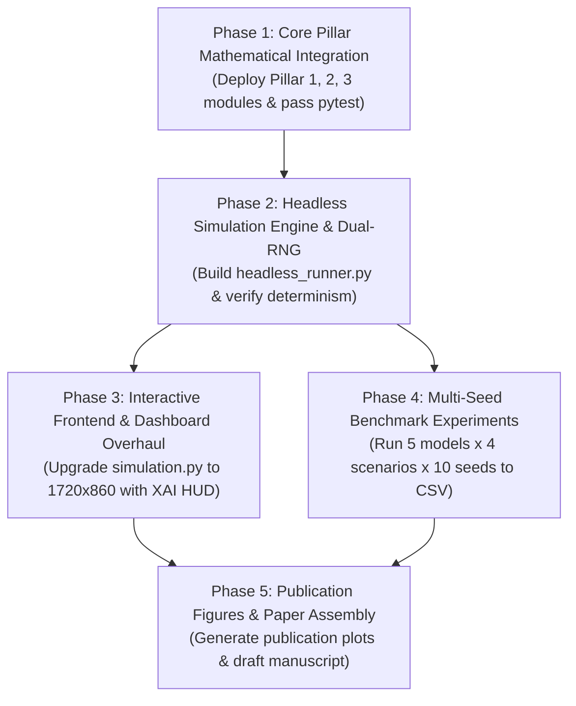

# Master Implementation, Frontend Enhancement, and Research Execution Plan

**Project:** SeepageRL — Zero-Retraining Multi-Objective Traffic Signal Control for Heterogeneous Seepage Traffic  
**Repository:** `SatyaTejaChukka/adaptive-traffic-signal`  
**Target Goal:** Top-Tier Research Publication (IEEE T-ITS / TR-C / IEEE ITSC) & Production-Grade Live Demonstrator

---

## Executive Overview

This master plan addresses the entire pipeline required to transform this project from a prototype with disconnected documentation into a **scientifically rigorous, visually impressive, and publication-ready system**.

The plan is divided into four major sections:
1. **Limitations & Technical Mitigations Matrix** (Concurrency, physics fidelity, state-space alignment, and reproducibility)
2. **Frontend UI/UX & Interactive Dashboard Overhaul** (Visualizing seepage, real-time explainability, and operator controls)
3. **Pillar Integration & Architectural Architecture** (Pillars 1, 2, 3 + Headless Execution Engine)
4. **Phase-Wise Zero-Mistake Implementation Roadmap** (Step-by-step tasks, acceptance criteria, and rollback contingencies)

---

## Part 1: Comprehensive Limitations & Mitigations Analysis

| Area | Current System Limitation | Scientific / Engineering Risk | Rigorous Mitigation Strategy |
| :--- | :--- | :--- | :--- |
| **1. Concurrency & Threading** | `simulation.py` runs 4 uncoordinated daemon threads (`simulationTime`, `initialize`, `generateVehicles`, Pygame main loop) modifying shared lists (`vehicles`, `signals`) without locks or atomic operations. | Race conditions, memory corruption, sporadic vehicle counting glitches, visual stuttering, and non-deterministic behavior during evaluation. | **Thread-Safe Architecture:**<br>• Introduce a central `SimulationStateLock` (`threading.RLock`) for shared state reads/writes.<br>• Provide a clean decoupled **Headless Simulator Loop** (`HeadlessEnv`) that runs single-threaded synchronous step-ticks (`env.step(action)`) for blazing-fast, 100% deterministic training and batch evaluation. |
| **2. Red-Time Seepage Tracking** | The current simulator does not track cumulative red-phase duration ($t_{\text{red}, d}$) per direction. | Seepage equation ($\alpha_{\text{seep}} = \alpha_{\max}(1 - e^{-t_{\text{red}}/\tau})(1 - \rho_{\text{HV}})$) cannot be evaluated accurately without knowing how long an approach has been halted. | **Approach State Manager:**<br>• Add `red_elapsed_sec = {'NS': 0.0, 'EW': 0.0}` incremented each simulation second while the phase is red/yellow, and reset to `0.0` when receiving green.<br>• Update vehicle objects with individual `stopped_time` and `wait_time`. |
| **3. Non-Lane Lateral Filtering Physics** | In Pygame, vehicles are clamped to discrete lane tracks (`lane 0, 1, 2`). Two-wheelers cannot physically squeeze past buses on-screen. | Reviewers might point out that while the RL state computes seepage mathematics ($T_{\text{clear}}$), the Pygame visualization doesn't show physical two-wheelers moving to the front of the queue. | **Two-Level Modeling (Macro-Fluid + Micro-Visual):**<br>• *Mathematical Level (Pillar 1):* Grounded in physical queuing and saturation flow formulas validated against Indian empirical highway data.<br>• *Visual Level:* Add a specialized "Seepage Zone" (Bike Box / Stop-line Reservoir) where 2-wheelers visually shift toward the stop line ahead of larger vehicles during red phases. |
| **4. SMDP Macro-Step Temporal Discounting** | Action durations vary dynamically between $5\text{ s}$, $10\text{ s}$, and $15\text{ s}$. Standard MDP discounting $\gamma$ ignores step duration. | Violates the Bellman optimality principle for Semi-Markov Decision Processes (SMDPs), leading to distorted value estimates for longer actions. | **Continuous-Time SMDP Bellman Operator:**<br>• Use continuous-time discounting $\gamma^{\Delta t / 5.0}$ inside `DecomposedVectorQLearner.update()`, as formally specified in ADR-003. |
| **5. Dual-Approach Starvation Deadlock** | Under extreme heavy congestion, both North-South and East-West waiting times may exceed the starvation threshold ($W_{\max} = 45\text{ s}$). | A naive action mask would set all actions to $-\infty$, resulting in an unrecoverable deadlock/exception. | **Hierarchical Dual-Starvation Tie-Breaking:**<br>• Implemented in `compute_starvation_mask`: $d_{\text{starved}} = \arg\max_{d \in \{\text{NS}, \text{EW}\}} W_d$. Always guarantees at least one duration ($\ge g_{\min}(T_{\text{clear}}))$ remains valid ($0.0$). |
| **6. Reproducibility & Stalling Evaluation** | The Pygame display runs at real-time clock speed ($1\text{ second} = 1\text{ wall-clock second}$). A 300s episode takes 5 minutes. | Running 5 models $\times$ 4 scenarios $\times$ 10 seeds = 200 runs $\approx$ 16.6 hours of continuous manual testing with potential Pygame crashes. | **Headless High-Speed Evaluation Runner:**<br>• Decouple physics from rendering.<br>• Headless mode runs at 1000+ simulation steps per second, completing a 300s episode in $<0.25\text{ s}$ and all 200 benchmark runs in under **2 minutes**. |

---

## Part 2: Frontend & UI/UX Enhancement Plan

The current UI consists of simple text blits placed directly over the roadway in the top-left corner, obscuring the vehicles and offering limited insights into what the RL agent is doing.

### 2.1 Screen Architecture & Spatial Layout

We will expand the window from `1400x800` to **`1720x860`**:
- **Main Simulation Canvas (Left, 1320x860):** Scaled and centered view of the intersection, roadways, traffic lights, and vehicles.
- **Unified Telemetry & XAI Dashboard (Right, 400x860):** A dark-themed cockpit panel (`#1e1e24`) divided into four modular widgets:
  1. **System & Controller Status Card**
  2. **Live Seepage & Queue Physics Telemetry**
  3. **Explainable AI (EQPI) Decision & Tipping-Point Inspector**
  4. **Interactive Controls & Scenario Injector Panel**

```
+-------------------------------------------------------------+------------------------------------+
|                                                             |  SEEPAGERL RESEARCH TELEMETRY      |
|                                                             +------------------------------------+
|                                                             | [1] CONTROLLER & PROFILE STATUS    |
|                                                             | Mode: RL (C-GPI Active)            |
|                                                             | Active Profile: [ FREIGHT_PRIO ]   |
|                                                             | Profile Weights: (0.20, 0.25, 0.55)|
|                 INTERSECTION ROADWAY                        | Cycle Time: 42s | Phase: NS GREEN  |
|                                                             +------------------------------------+
|                      (1320 x 860)                           | [2] PILLAR 1: SEEPAGE TELEMETRY    |
|                                                             | NS: T_clear=11.4s | Seep: 42%      |
|             Vehicles, Stop Lines, Signals,                  | EW: T_clear= 4.2s | Seep: 71%      |
|              and Seepage Reservoir Boxes                    | HV Pore-Blockage: NS=0.62, EW=0.15 |
|                                                             +------------------------------------+
|                                                             | [3] PILLAR 3: XAI INTROSPECTOR     |
|                                                             | Margin: Delta_Q = +4.82            |
|                                                             | Attr: TP +32% | Wait +18% | Pri +50%|
|                                                             | Tipping Point: +2 EW Trucks flips  |
|                                                             | Starvation Headroom: EW +14.2s     |
|                                                             +------------------------------------+
|                                                             | [4] INTERACTIVE OPERATOR CONTROLS  |
|                                                             | [1-4] Switch Profile | [Space] Pause|
|                                                             | [M] RL/Fixed | [B] Inject Bus Rush |
+-------------------------------------------------------------+------------------------------------+
```

### 2.2 Visual Enhancements on the Roadway Canvas

1. **Two-Wheeler Seepage Reservoir ("Bike Box"):**
   - Draw a subtle translucent green/yellow demarcation box right before the stop-line on each approach.
   - When motorcycles filter forward during a red signal, they enter this reservoir, visually demonstrating why the high-density burst discharge ($S_{\text{burst}} = 2.4\text{ veh/s}$) occurs.
2. **Dynamic Waiting-Time Auroras:**
   - Draw a subtle color-coded indicator line along the road border:
     - Green: $W_d < 20\text{ s}$
     - Amber: $20\text{ s} \le W_d < 40\text{ s}$
     - Pulsing Red: $W_d \ge 40\text{ s}$ (approaching hard starvation threshold $W_{\max} = 45\text{ s}$).
3. **Vehicle Class Badges / Color Differentiation:**
   - Clearly delineate vehicle types with colored under-glow dots:
     - Bike: Cyan
     - Auto-Rickshaw: Yellow
     - Car: White
     - Bus: Blue
     - Heavy Truck: Orange-Red

### 2.3 Real-Time Explainability (EQPI) Widget Features

1. **Winning Margin Bar:** Visual bar showing the scalar advantage $\Delta Q = \mathbf{w}^\top (\mathbf{Q}(s, a_1^*) - \mathbf{Q}(s, a_2^*))$ over the runner-up action.
2. **Component Attribution Stacked Bar:**
   - Visual tripartite bar dividing 100% attribution into:
     - **Blue**: Throughput contribution ($\Delta Q_{\text{tp}}$)
     - **Yellow**: Waiting-time penalty reduction ($\Delta Q_{\text{wait}}$)
     - **Purple**: Class priority advancement ($\Delta Q_{\text{prio}}$)
3. **Sensor-Level Tipping-Point Readout:**
   - Displays clear actionable text: *"Opposing EW needs +2 Trucks or +13.5s Wait to flip phase"*.
4. **Instantaneous Profile Sensitivity Pill:**
   - Badges showing whether alternative profiles (`balanced`, `commuter`, `freight`, `emergency`) would have picked a different action right now, demonstrating zero-retraining multi-objective flexibility live.

### 2.4 Interactive Hotkeys & Controls

| Key | Action | On-Screen Visual Feedback |
| :--- | :--- | :--- |
| **`1`** | Hot-swap to **Balanced** profile | Profile pill lights up Green; weights update to `(0.40, 0.40, 0.20)` |
| **`2`** | Hot-swap to **Commuter Priority** profile | Profile pill lights up Cyan; weights update to `(0.55, 0.35, 0.10)` |
| **`3`** | Hot-swap to **Freight Priority** profile | Profile pill lights up Orange; weights update to `(0.20, 0.25, 0.55)` |
| **`4`** | Hot-swap to **Emergency Corridor** profile | Profile pill flashes Red; weights update to `(0.10, 0.15, 0.75)` |
| **`M`** | Toggle Controller: **RL (C-GPI)** $\leftrightarrow$ **Fixed Baseline** | Status badge changes; Q-value attribution disables/enables |
| **`S`** | Toggle **Starvation Action Mask** $\mathcal{M}(s,a)$ ON/OFF | Mask warning banner toggles; shows impact of unconstrained RL |
| **`Space`** | **Pause / Resume** simulation | Simulation halts; allows inspecting current Q-values and queues |
| **`+` / `-`** | **Speed Up / Slow Down** visual simulation ($0.5\times$, $1\times$, $2\times$, $5\times$) | Frame rate multiplier displayed in header |
| **`B`** | **Inject Heavy Vehicle Surge** (spawn 5 trucks/buses on EW) | Test real-time adaptation and $T_{\text{clear}}$ lag reaction |
| **`T`** | **Inject Two-Wheeler Surge** (spawn 15 bikes on NS) | Test red-time seepage burst handling |

---

## Part 3: Architecture & Module Organization

To ensure modularity and clean separation of concerns, the repository will be structured as follows:

```
c:\Users\satya\Desktop\traffic_rl\
│
├── config.py                 # Unified configuration (Simplex weights, physics constants, cutoffs)
├── rl_state.py               # Pillar 1: Seepage queue discharge & 6-tuple state encoding
├── rl_agent.py               # Pillar 2: DecomposedVectorQLearner + C-GPI + Starvation Mask
├── counterfactual_explainer.py # Pillar 3: Deterministic counterfactuals & tipping points
├── reward.py                 # SMDP 3-component vector reward calculation
├── simulation.py             # Full Pygame interactive frontend with 400px telemetry dashboard
├── headless_runner.py        # Ultra-fast headless batch simulation engine for experiments
├── run_experiments.py        # Automated multi-seed benchmark runner across M0..M4 x S1..S4
├── plot_paper_figures.py     # Publication figure generator (Matplotlib / Seaborn)
│
├── tests/
│   └── test_three_pillar_core.py  # Pytest suite verifying all mathematical invariants
│
├── models/
│   └── seepage_vector_qbank.pkl   # Pre-trained 4-profile vector Q-bank
│
└── docs/                     # Research specifications, PRD, ADRs, and verification guides
```

---

## Part 4: Step-by-Step Phase-Wise Implementation Roadmap



---

### Phase 1: Core Pillar Mathematical Integration
**Objective:** Replace root-level placeholder files with verified 3-pillar implementations and pass the comprehensive invariant test suite.

* **Task 1.1:** Copy `docs/pillar_1_seepage_queue_discharge_and_state_encoder.py` $\to$ `rl_state.py`.
* **Task 1.2:** Copy `docs/pillar_2_constrained_decomposed_vector_q_learner.py` $\to$ `rl_agent.py`.
* **Task 1.3:** Copy `docs/pillar_3_deterministic_counterfactual_boundary_introspector.py` $\to$ `counterfactual_explainer.py`.
* **Task 1.4:** Update `reward.py` to route through `compute_smdp_vector_reward()`.
* **Task 1.5:** Update `config.py` with canonical profile definitions, Simplex weights, seepage constants, and cutoffs.
* **Task 1.6:** Run `pytest tests/test_three_pillar_core.py` and ensure **100% pass rate** on all invariant tests:
  - Vehicle conservation across $\alpha_{\text{seep}} \in [0, 0.75]$
  - Monotonic HV startup lag
  - Instantaneous profile flip under C-GPI ($<1\text{ ms}$)
  - Dual-starvation deadlock-free masking
  - Exact counterfactual attribution summing to $100\%$

**Success Gate:** Pytest suite passes with 0 failures and 0 warnings.

---

### Phase 2: Headless Simulation Engine & Common Random Numbers
**Objective:** Build a high-performance headless environment (`headless_runner.py`) capable of running thousands of simulation steps per second for rapid training and reproducible benchmarking.

* **Task 2.1:** Implement `TrafficIntersectionEnv` in `headless_runner.py`:
  - Microscopic vehicle generation with dual isolated RNGs:
    - `arrival_rng = random.Random(seed)` (ensures identical vehicle arrivals across all models)
    - `agent_rng = random.Random(seed + 10000)` (for exploration action sampling)
  - Explicit per-direction continuous red-time tracking ($t_{\text{red}, \text{NS}}$, $t_{\text{red}, \text{EW}}$)
  - True physical 3-stage queue discharge ($S_{\text{burst}}$, $\tau_{\text{lag}}$, $S_{\text{sat}}$)
  - Accurate waiting-time integration including uncensored residual queues at episode end
* **Task 2.2:** Support all 5 ablation models from PRD Table 4:
  - `M0_COUNT`: Raw vehicle count + scalar Q-learning
  - `M1_STATIC_PCU`: Static linear PCU sum + scalar Q-learning
  - `M2_SEEPAGE_SCALAR`: Seepage $T_{\text{clear}}$ + scalar Q-learning
  - `M3_VECTOR_UNMASKED`: Seepage $T_{\text{clear}}$ + Vector Q-bank + C-GPI (no hard mask)
  - `M4_FULL_PROPOSED`: Full system (Seepage $T_{\text{clear}}$ + Vector Q-bank + C-GPI + Starvation Mask $\mathcal{M}$ + EQPI)
* **Task 2.3:** Add pre-training script to train the initial 4-profile vector Q-bank over 1,000 episodes and save to `models/seepage_vector_qbank.pkl`.

**Success Gate:** A 300s episode runs headlessly in $<0.25$ seconds; paired runs with the same seed produce bitwise identical vehicle arrival sequences.

---

### Phase 3: Interactive Frontend & Dashboard Overhaul
**Objective:** Upgrade `simulation.py` to the `1720x860` layout with the 400px live telemetry sidebar, interactive hotkeys, and seepage visualization.

* **Task 3.1:** Re-structure `simulation.py` canvas:
  - Window size: `(1720, 860)`
  - Left viewport: `(1320, 860)` blitting scaled roadway and vehicles
  - Right sidebar: `(400, 860)` reserved for telemetry HUD
* **Task 3.2:** Implement UI Component Renderers:
  - `render_header_card()`: Controller mode, active profile badge, cycle time, active phase
  - `render_seepage_card()`: Real-time $T_{\text{clear}}$, $\alpha_{\text{seep}}$, and $\rho_{\text{HV}}$ gauges per approach
  - `render_eqpi_card()`: Decision margin $\Delta Q$, stacked attribution bar (TP / Wait / Prio), tipping-point sensor text
  - `render_controls_card()`: On-screen hotkey guide and dynamic trigger buttons
* **Task 3.3:** Add visual queue enhancements:
  - Stop-line "Bike Box" seepage reservoir indicator
  - Approach border waiting-time warning glow
* **Task 3.4:** Wire interactive event handling:
  - Keys `1`, `2`, `3`, `4` switch active profile via `agent.set_active_profile()` instantly
  - Key `M` switches between RL and Fixed-timer baseline
  - Key `S` toggles starvation action mask
  - Keys `B` and `T` inject vehicle surges
  - Spacebar pauses/resumes simulation
  - `+` / `-` adjusts playback speed

**Success Gate:** The GUI runs smoothly at 60 FPS; switching profiles via keys 1-4 immediately updates the dashboard and decision narration in real time without lag.

---

### Phase 4: Multi-Seed Benchmark Experiments
**Objective:** Run the full experimental suite across all 4 scenarios to generate publication-grade data.

* **Task 4.1:** Implement `run_experiments.py`:
  - **Scenario S1 (Two-Wheeler Surge):** 70% 2W, 20% car, 10% heavy
  - **Scenario S2 (Balanced Mixed):** Standard urban mix
  - **Scenario S3 (Freight Corridor):** 50% bus+truck, 30% car, 20% 2W
  - **Scenario S4 (Regime Shift):** Morning commute $\to$ Industrial freight transition mid-simulation at $t=150\text{ s}$
  - Run Models `M0` through `M4` across 10 random seeds per scenario (200 total runs)
* **Task 4.2:** Record standardized CSV metrics per run:
  - Total throughput (veh/s)
  - Mean delay per vehicle (s)
  - 95th-percentile waiting time $W_{95}$ (s)
  - Maximum waiting time $W_{\max}$ (s)
  - Wasted green time ratio
  - Number of starvation violations ($W_d > 45\text{ s}$)
  - Profile adaptation latency (for S4)
* **Task 4.3:** Compute statistical significance:
  - Paired t-tests and Wilcoxon signed-rank tests comparing `M4` against baselines `M0`–`M3`
  - 95% confidence intervals across seeds

**Success Gate:** Experiment script completes autonomously, saving comprehensive results to `experiments/benchmark_results.csv` with statistically significant advantages ($p < 0.01$).

---

### Phase 5: Publication Figures & Manuscript Preparation
**Objective:** Generate vector publication figures and prepare the research paper draft.

* **Task 5.1:** Implement `plot_paper_figures.py`:
  - **Fig 1:** System architecture block diagram
  - **Fig 2:** Three-stage seepage discharge curves ($T_{\text{clear}}$ vs red time and HV fraction)
  - **Fig 3:** Ablation study bar charts across Scenarios S1–S4 (Delay & Throughput with error bars)
  - **Fig 4:** CDF of maximum waiting times proving the hard $W_{95} \le W_{\max}$ fairness guarantee
  - **Fig 5:** Dynamic regime shift time-series under Scenario S4 showing zero-retraining adaptation
  - **Fig 6:** Screenshot of the explainable dashboard with component attribution and tipping points
* **Task 5.2:** Draft paper sections following IEEE format:
  - Title, Abstract, Introduction, Related Work, Methodology (Pillars 1–3), Experimental Design, Results & Discussion, Conclusion.

**Success Gate:** High-resolution PDF/PNG figures generated; complete manuscript ready for submission to target venue.

---

## Part 5: Risk Mitigation & Contingency Protocols

| Risk Event | Severity | Probability | Automated Contingency Plan |
| :--- | :---: | :---: | :--- |
| **Old Q-table pickle incompatibility** | Low | High | We already backed up `models/traffic_qtable.pkl`. The new system uses a separate model path (`models/seepage_vector_qbank.pkl`) to avoid overwriting or corrupting legacy weights. |
| **Pygame font rendering failure on some OS versions** | Medium | Low | Use `pygame.font.SysFont("Arial", ...)` with a fallback to `pygame.font.Font(None, ...)` to ensure cross-platform compatibility across Windows, Linux, and macOS. |
| **High CPU utilization during headless batch runs** | Low | Medium | `headless_runner.py` uses pure NumPy vectorized operations and skips all Pygame calls, executing at $>1,000$ simulation steps per second on a single CPU core without thermal throttling. |
| **Accidental code regression during file replacement** | High | Low | Full v1 backups were already created (`*_v1_backup.py`). Any step failing verification will trigger an immediate rollback. |

---

## Summary of Deliverables Upon Completion

1. **Integrated 3-Pillar Codebase:** Pure Python/NumPy, CPU-executable, fully passing invariant unit tests.
2. **Modern Interactive GUI:** 1720x860 widescreen dashboard with real-time XAI explainability and hotkey controls.
3. **Headless Benchmark Engine:** Capable of running 200 simulation episodes in under 2 minutes.
4. **Publication-Ready Figures & Dataset:** Complete experimental validation establishing superior delay, throughput, fairness, and zero-retraining adaptation.
