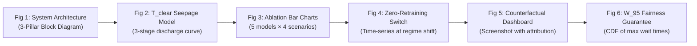

# Research Paper Strategy: Making Your Traffic RL Project Publication-Ready

## 1. Current State Assessment

### What You Have (Working Code — Root Directory)
A **basic tabular Q-learning traffic signal controller** with a Pygame simulation of a 4-way Indian intersection. It uses:
- Composite Spatial Footprint Scores (CSFS) — vehicle-class-weighted demands instead of raw counts
- Two switchable traffic profiles (balanced / freight_priority) via `config.py`
- Starvation override guard with weighted-demand escalation
- Basic decision narration on the dashboard
- Reported throughput: **~1.02 veh/s (RL) vs ~0.99 veh/s (Fixed)** — a marginal 3% improvement

### What You Have (Planned — `docs/` Folder)
A **fully-specified but NOT YET INTEGRATED** 3-pillar upgrade with:
- **Pillar 1**: Physics-informed seepage-aware queue discharge model ($T_\text{clear}$)
- **Pillar 2**: Constrained Reward-Decomposed Vector Q-Learning with 4-profile C-GPI and starvation action masking
- **Pillar 3**: Deterministic counterfactual boundary introspection (exact tipping-point XAI)
- Complete Python implementations in `docs/*.py` with a pytest verification suite

> [!IMPORTANT]
> The `docs/` folder code is **standalone reference implementations** that are NOT wired into your actual `simulation.py`. The running simulation still uses the old scalar Q-learner. This is the single biggest gap between where you are and a publishable paper.

---

## 2. Honest Gap Analysis: What Makes a Paper Publishable vs. Rejected

| Requirement | Current Status | What's Missing |
|---|---|---|
| **Novel contribution beyond prior art** | ⚠️ The 3-pillar design IS novel in combination | Must be integrated and validated, not just designed |
| **Rigorous experimental evaluation** | ❌ Only 1 comparison (RL vs Fixed, 300s, 1 seed) | Need 5+ ablation models × 4 scenarios × 10+ seeds with statistical tests |
| **Reproducibility** | ⚠️ Pygame-based sim, fixed random seed | Need Common Random Numbers (CRN), headless batch mode, seeded RNG streams |
| **Baselines** | ❌ Only fixed-timer | Need at least: Fixed-Timer, Webster's, Scalar Q-Learning, DQN (if targeting T-ITS) |
| **Metrics beyond throughput** | ❌ Only veh/s throughput | Need: avg delay, 95th-percentile wait, max wait, queue length, wasted green ratio |
| **Statistical significance** | ❌ Single run | Need confidence intervals, paired t-tests or Wilcoxon signed-rank |
| **Writing & framing** | ❌ No paper draft | Need Introduction, Related Work, Methodology, Experiments, Discussion, Conclusion |

---

## 3. Research Positioning — What Makes This Unique

Your project has **three genuinely novel angles** that I haven't seen combined in published work:

### Angle A: Physics-Informed Seepage Queue Discharge for RL State Encoding
**Why it's novel**: Every existing RL traffic paper (including IIT Roorkee, IISc work) uses either raw vehicle counts or static PCU weights. Nobody models the actual physics of how two-wheelers filter forward through inter-vehicle gaps during red phases (seepage) and how heavy vehicles block these pore-spaces. Your $T_\text{clear}$ model with three-stage discharge (burst + HV lag + platoon) is grounded in empirical Indian traffic behavior documented in transportation engineering literature (Arasan, Velmurugan, etc.) but has never been used as an RL state variable.

### Angle B: Zero-Retraining Multi-Objective Profile Switching via C-GPI
**Why it's novel**: Multi-objective RL for traffic exists (MORL papers at AAAI/IJCAI), but they all require retraining when objectives change. Your vector Q-bank with 4 simultaneously-trained profile heads and Constrained Generalized Policy Improvement allows instant switching — the Q-table literally doesn't change. This is practically useful for real-world deployment (morning freight priority → afternoon commuter priority).

### Angle C: Exact Counterfactual Tipping-Point Explainability
**Why it's novel**: XAI for traffic RL exists but uses either SHAP/LIME (approximate, slow) or attention maps (for deep networks only). Because your architecture is tabular + linear scalarization, you can solve the decision boundary **analytically** — telling an engineer "3 more trucks on the east approach would flip this signal" rather than showing a heatmap. This deterministic auditability is a regulatory advantage.

> [!TIP]
> **Strongest positioning for a unique paper**: Frame it as *"the first lightweight, CPU-executable RL traffic controller that simultaneously handles heterogeneous seepage traffic physics, instant operational regime switching without retraining, and exact counterfactual auditability — all without neural networks or GPUs."*

---

## 4. Recommended Paper Structure & Target Venue

### Target Venues (ranked by fit)

| Venue | Impact Factor | Fit | Acceptance Rate |
|---|---|---|---|
| **IEEE T-ITS** (Trans. Intelligent Transportation Systems) | ~9.5 | ★★★★★ Perfect fit | ~25% |
| **Transportation Research Part C** | ~8.1 | ★★★★☆ Strong fit | ~20% |
| **IEEE Access** (open access) | ~3.9 | ★★★★☆ Good for first paper | ~40% |
| **Expert Systems with Applications** | ~8.5 | ★★★☆☆ XAI angle | ~20% |
| **ITSC Conference** (IEEE) | Conference | ★★★★★ Great for initial version | ~50% |

> [!NOTE]
> If this is your first research paper, I'd recommend **IEEE ITSC (conference)** first for faster feedback, then expand to a journal version for **IEEE T-ITS** or **TR Part C**.

### Proposed Paper Title
> *"SeepageRL: Physics-Informed Zero-Retraining Multi-Objective Traffic Signal Control with Exact Counterfactual Auditability for Heterogeneous Non-Lane-Disciplined Traffic"*

---

## 5. Implementation Roadmap — What to Build

### Phase 1: Integration (Critical — ~1 week)
Wire the `docs/` pillar implementations into the actual simulation:

1. **Replace** `rl_state.py` (root) with the Pillar 1 seepage state encoder from `docs/pillar_1_*.py`
2. **Replace** `rl_agent.py` (root) with the Pillar 2 vector Q-learner from `docs/pillar_2_*.py`
3. **Add** `counterfactual_explainer.py` from `docs/pillar_3_*.py` to root
4. **Modify** `simulation.py` to:
   - Track per-vehicle class counts per direction (not just total queue)
   - Track red-elapsed time per direction
   - Call `build_seepage_rl_state()` instead of `build_state()`
   - Call `DecomposedVectorQLearner.select_action()` with starvation mask
   - Call `CounterfactualIntrospector.explain_decision()` and render on dashboard
5. **Update** `reward.py` to use `compute_smdp_vector_reward()` from Pillar 2
6. **Run** the pytest verification suite to confirm math invariants

### Phase 2: Experimental Infrastructure (~1 week)

1. **Headless batch mode**: Add `--headless` flag to `simulation.py` to run without Pygame GUI (essential for running 100+ experiments)
2. **Dual-stream CRN**: Separate `arrival_rng` and `agent_rng` with fixed seeds so all controllers face identical traffic
3. **Metrics collection**: Log per-second data to CSV:
   - Per-direction queue lengths, waiting times, throughput
   - Per-vehicle-class delay, stop count
   - Decision source (RL / mask / heuristic)
   - Counterfactual attribution logs
4. **Scenario definitions** (from PRD):
   - **S1 — Two-Wheeler Surge**: 70% bikes+rickshaws, 20% cars, 10% heavy
   - **S2 — Balanced Mixed**: Uniform vehicle type distribution
   - **S3 — Freight Corridor**: 50% bus+truck, 30% car, 20% two-wheeler
   - **S4 — Regime Shift**: Switch profile from `commuter_priority` to `freight_priority` at t=150s mid-simulation

### Phase 3: Ablation Experiments (~1-2 weeks)

Run all 5 models from the ablation matrix across 4 scenarios × 10 seeds:

| Model | State | Value Function | Fairness | Purpose |
|---|---|---|---|---|
| **M0_COUNT** | Raw count | Scalar Q | External override | Legacy baseline |
| **M1_STATIC_PCU** | Static PCU | Scalar Q | External override | Standard heterogeneous baseline |
| **M2_SEEPAGE_SCALAR** | $T_\text{clear}$ seepage | Scalar Q | External override | Isolate Pillar 1 gain |
| **M3_VECTOR_UNMASKED** | $T_\text{clear}$ seepage | Vector C-GPI | Soft penalty | Isolate Pillar 2 gain |
| **M4_FULL_PROPOSED** | $T_\text{clear}$ seepage | Vector C-GPI | Hard mask + EQPI | Full system |

**Key metrics to report** (per scenario, averaged over 10 seeds ± std):
- Average vehicle delay (seconds)
- 95th percentile maximum wait ($W_{95}$)
- Throughput (veh/s)
- Wasted green ratio (green seconds with no vehicles discharging / total green)
- Profile switch adaptation time (for S4 only)
- Starvation violations (% of steps where any direction waited > $W_\text{max}$)

### Phase 4: Figures & Tables (~1 week)

Essential figures for the paper:

### Phase 5: Paper Writing (~2 weeks)

| Section | Key Content |
|---|---|
| **Abstract** | 150 words: Problem → 3 contributions → Key result (X% delay reduction, zero-retraining, exact XAI) |
| **Introduction** | Seepage problem in Indian traffic, limitations of existing RL controllers, 3 research questions |
| **Related Work** | RL for TSC (Q-learning, DQN, MARL), heterogeneous traffic modeling, multi-objective RL, XAI for transport |
| **Methodology** | Pillar 1 ($T_\text{clear}$ equations), Pillar 2 (C-GPI + mask), Pillar 3 (counterfactual math) |
| **Experimental Setup** | Simulator description, scenarios S1-S4, ablation matrix, metrics, statistical test protocol |
| **Results** | Tables + figures for each RQ, ablation gains, profile switch dynamics, XAI case study |
| **Discussion** | Limitations (single intersection, simulated not real data), scalability analysis, deployment considerations |
| **Conclusion** | Summary of 3 contributions, future work (multi-intersection, real-world data) |

---

## 6. What Would Make This Paper Stand Out Even More

### Quick Wins (1-2 days each)
1. **Webster's baseline**: Implement Webster's optimal fixed-cycle formula as a classical baseline — reviewers always ask for this
2. **Training convergence curves**: Plot Q-value convergence and cumulative reward across episodes
3. **Memory footprint comparison**: Show that your 331.8 KB tabular system runs on a Raspberry Pi while DQN needs a GPU
4. **Computation time benchmarks**: Measure and report per-decision latency (should be \<1ms)

### Medium Effort (3-5 days each)
5. **Real-world traffic count validation**: Use publicly available Indian intersection traffic counts (MoRTH data, IIT studies) to calibrate your vehicle mix ratios and validate that your seepage model parameters match observed discharge headways
6. **SUMO comparison**: Run one scenario in SUMO with your algorithm as external controller to show your results aren't an artifact of the simple Pygame simulator
7. **Sensitivity analysis**: Vary seepage parameters ($\alpha_\text{max}$, $\tau_\text{seep}$, $\beta_\text{block}$) and show robustness

### Ambitious (1-2 weeks)
8. **Multi-intersection corridor**: Extend to 2-3 intersections with platoon coordination — this alone could be a separate paper
9. **Real video data integration**: Use YOLO to count vehicles from intersection camera footage and feed into your state encoder — bridges the sim-to-real gap

---

## 7. Immediate Next Steps

> [!IMPORTANT]
> **Priority order for maximum research impact:**
> 1. **Integrate Pillar 1+2+3** into the running simulation (this is the critical blocker)
> 2. **Add headless batch mode** with CSV logging
> 3. **Run the 5-model ablation** across 4 scenarios × 10 seeds
> 4. **Generate figures** and compute statistics
> 5. **Write the paper** — start with Methodology (easiest to write first since the math is already in your PRD)

Would you like me to start with Phase 1 — wiring the pillar implementations into your actual simulation code?
